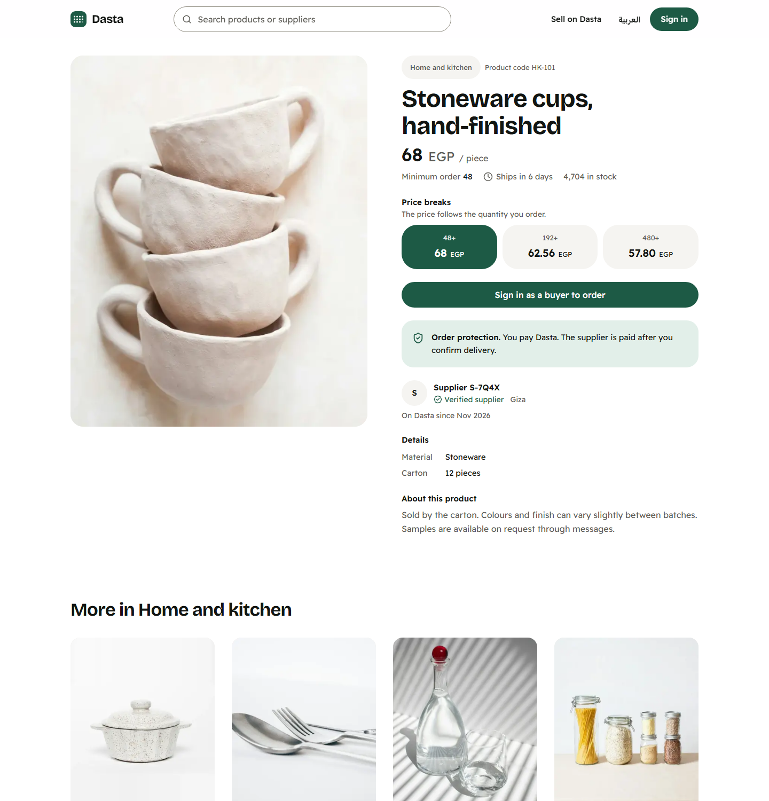
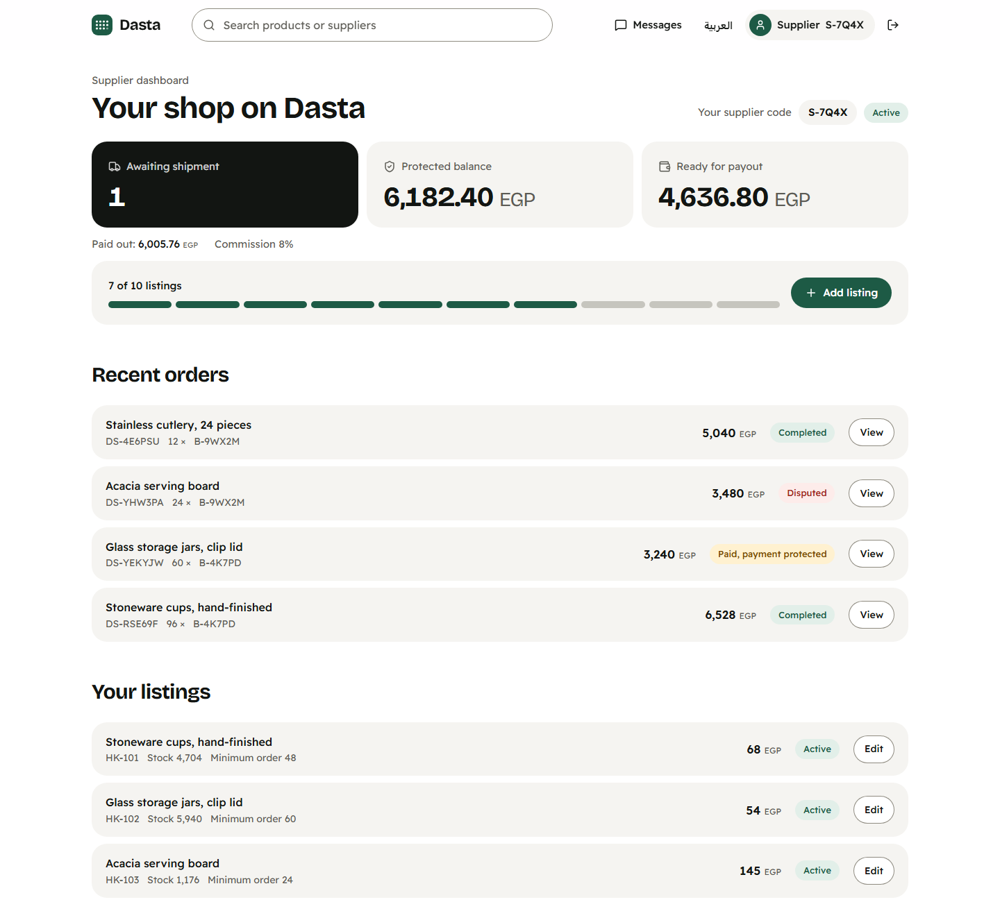
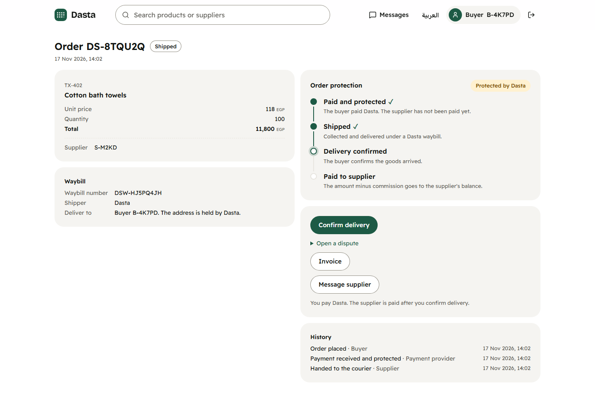
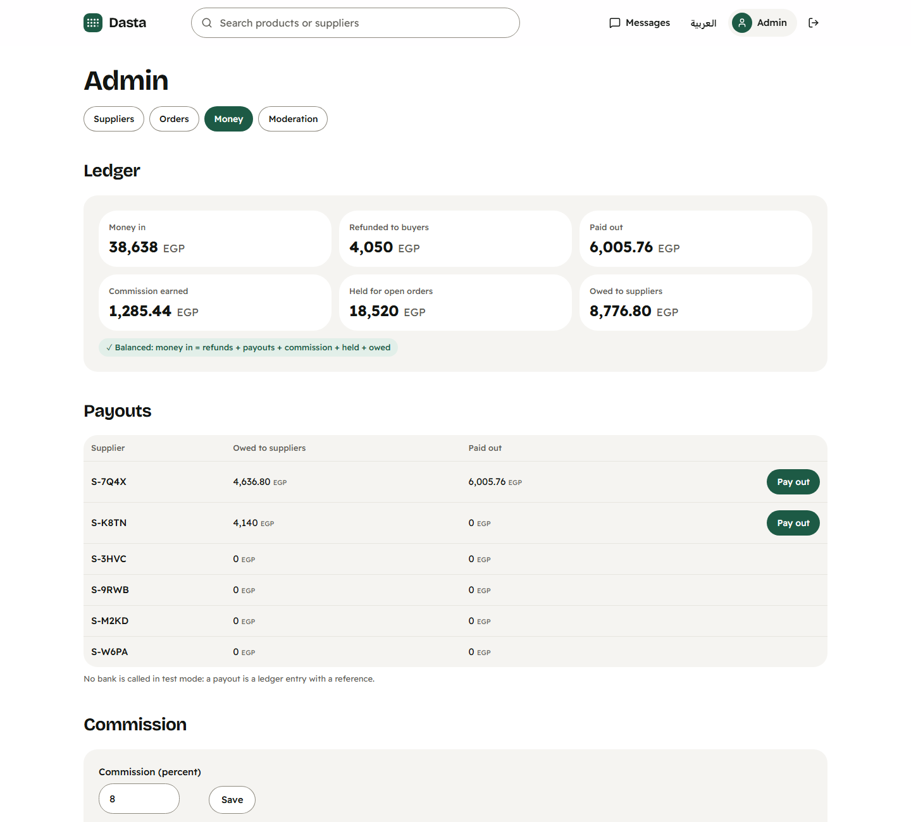

# Dasta

A wholesale marketplace in English and Arabic. Shops, cafes and offices order by the carton from
verified suppliers; the payment is held until the goods arrive; buyers and suppliers talk through
messages that stay on the platform.

**Live:** <https://dasta-wholesale.vercel.app>

> Dasta is a portfolio project by [Ahmed Shabayek](https://ashabaik.github.io), not a trading business
> and not client work. Suppliers, buyers, products and prices are sample data, reset every night.
> Payments run in test mode: no card is charged.


## What you can do

Sign in on the [sign-in page](https://dasta-wholesale.vercel.app/en/signin) with one of the sample
accounts, or open a new supplier account on the spot.

| Account | Try this |
| --- | --- |
| Buyer | Pick a quantity and see the price break apply, order, pay on the test-mode payment page (success or failure), confirm delivery, rate the supplier, open a dispute, message the supplier |
| Supplier | See orders and balance, mark an order as shipped, edit listings (10 at most) with minimum order and price breaks, upload a photo, try to send a phone number in a message |
| Admin | Approve suppliers, open a supplier's company details with a recorded reason, resolve disputes, pay out suppliers, change the commission, review stopped messages and listings |
| New supplier | Open an account from zero and list a product |

| Screens | |
| --- | --- |
|  |  |
| Product page: price breaks, minimum order, order protection | Supplier dashboard: figures counted from the orders and the ledger |
|  |  |
| Order page: where the payment is at every step | Ledger: money in = refunds + payouts + commission + held + owed |

More screenshots are in [`docs/screenshots/`](docs/screenshots/).

## Stack

Next.js 16 (App Router, React 19, TypeScript), Tailwind CSS 4 with shadcn/ui on Radix and lucide icons,
Supabase (PostgreSQL 17 with row level security, Auth, Storage, Realtime), deployed on Vercel.
Migrations are plain SQL in [`supabase/migrations/`](supabase/migrations/).

## Design and motion

- A white page, warm light surfaces, heavy headings, one deep green. Photographs lead: tall, with no
  box, border or shadow around them. Arabic and English are both designed, not mirrored.
- The home page is directed like a short film: one opening sequence, one signature scene (on a desktop
  the category row is held and travels sideways with the scroll, mirrored in Arabic), and a last screen
  that the page lifts to reveal. GSAP (ScrollTrigger, SplitText) and Lenis load after the first paint,
  on desktop only.
- Phones have their own choreography in plain CSS and download no animation library.
- Product, order, dashboard and admin pages are working screens: no smooth-scroll layer, nothing held.
  The product photograph travels from the list to its page (React view transitions).
- Nothing moves for visitors who prefer reduced motion, and every page is complete with JavaScript off.
- Text is revealed by lines, never by letters, so Arabic stays joined.

## Security design

The rule the whole project is built around: **a supplier's company name, address, phone and bank details
must not reach a buyer or another supplier through any page, API response, file or error message.** The
rule is enforced in the database, not in the pages.

### Public and private data are in different schemas

| Schema | Holds | Who can reach it |
| --- | --- | --- |
| `public` | Supplier code, region (governorate), verified flag, rating, listings, orders, delivered messages | Exposed by the Data API. Row level security on every table. Every grant is written by hand in a migration. |
| `private` | Supplier and buyer company details, the link between a login and a supplier or buyer id, roles, audit log, ledger, payment records, original text of stopped messages | Not exposed by the Data API. The roles used by visitors (`anon`, `authenticated`) have **no privilege on the schema at all**. |
| `app` | Small helper functions used by the policies and constraints | Functions only, no tables |

In the database a supplier is a row in `sellers`; the interface says "supplier" throughout.

- A supplier's public id is a random UUID that is **not** the login's id. The mapping is in `private`.
- Product links use a random reference (`P-8K2M4Q`), never a name. Suppliers appear as a random code (`S-7Q4X`).
- The web app talks to the database with **the visitor's own session**, so row level security applies to
  every query a page makes. The privileged key is used in four places only: the seed, creating a new
  sample account, storing a re-encoded photo, and applying a verified payment callback or message.
- Everything a user may do with private data goes through a database function:
  `seller_onboard`, `seller_my_identity` (own data only; the id comes from the session, not from an argument).
- **The admin has no direct SELECT on company details either.** The only door is
  `admin_reveal_seller_identity(seller_id, reason)`, which writes the audit row *before* it returns the
  data, in the same transaction. An unrecorded read is impossible by construction.

### Leak paths and what closes them

| Leak path | How it is closed | Checked by |
| --- | --- | --- |
| API responses returning whole rows | Private columns are not in any table a visitor can query | `tests/db/privacy.test.mjs` reads every table of every schema as visitor, buyer, another supplier |
| Functions called with someone else's id | Functions take the caller from the session; admin functions check the role in the database | Same file: calls every function with another supplier's id |
| GraphQL endpoint, auth admin API | Private schema is not exposed; normal sessions are refused | Same file |
| Ids and slugs | Random UUIDs and random codes; the supplier id is not the account id | Same file |
| Pages, React data payloads, headers | Pages select public columns only | `scripts/crawl-test.mjs` opens every page as 6 kinds of visitor, HTML and data payload |
| Shared caches | `Cache-Control: private, no-store` on every page; component cache switched off | Crawl test fails on any cacheable page |
| Image metadata (EXIF, GPS, file name) | Photos are re-encoded on the server with `sharp`; a supplier's upload is stored under a random name; users cannot write to the bucket | `tests/unit/photo.test.ts`, and a live upload check during the build |
| Supplier-written listing text | Same contact-details check as messages; a hit saves the listing as "under review", hidden until the admin approves | `tests/db/chat.test.mjs`, `tests/db/wholesale.test.mjs` (through the API, bypassing the app) |
| Messages | Server check plus a second check in the database; stopped messages are invisible to the other party | `tests/unit/contact-filter.test.ts`, `tests/db/chat.test.mjs`, crawl test |
| Dispute text | The reason is a fixed code; the buyer's free-text note is for the admin only | `tests/db/ledger.test.mjs` |
| Reviews | Ratings are stars only, no text, and only from a buyer whose order was completed | `tests/db/ratings.test.mjs` |
| Invoice, receipt, waybill | Issued in the platform's name; the supplier appears as a code | Crawl test covers invoice pages; assumption below |
| E-mail | The project sends no e-mail at all | By design |
| Error messages | Database messages are mapped to fixed keys; an error page shows no details | Crawl test fails on any page that shows an internal message |
| Exact dates and "online now" | Suppliers show the month they joined; there is no presence | By design |
| The admin's own tools | Company details only through the recorded function | `tests/db/privacy.test.mjs` |

### The 10-listing limit

A trigger locks the supplier's row, counts the supplier's listings and refuses the 11th. Because of the
row lock, requests that arrive together wait for each other. The test sends 20 inserts at the same moment
for a supplier with 8 listings: exactly 2 succeed. A second test does the same with 12 parallel database
connections.

## Wholesale terms

Each listing carries a unit, a minimum order quantity, a lead time and up to four price breaks.

- The table itself refuses price breaks that do not make sense (quantities must rise above the minimum,
  prices must fall below the base price).
- The order function refuses a quantity below the minimum and works out the unit price from the listing.
  The browser never sends a price.

## Protected payment and the ledger

```text
pending_payment -> paid_held -> shipped -> completed (paid to the supplier's balance) -> payout
                      |            |
                      v            v
                   refunded     disputed -> completed | refunded   (admin decides)
```

- An order changes state only inside database functions. Users have SELECT on orders and nothing else.
- Every money movement is one double-entry ledger transaction, written in the same database transaction
  as the state change. A constraint checks at commit that its entries sum to zero.
- The ledger is append-only: UPDATE and DELETE are refused for every role, including the owner.
- Commission is stored on each order when it is placed, so changing the rate affects new orders only.
  The 8% default is a sample value.
- Invariant checked after every test scenario and shown on the admin's Money page:
  **money in = refunds + payouts + commission + still held + still owed to suppliers.**

## Payments

No real payment provider is connected and no real money moves. The payment page says so first.

- Paymob's test mode needs a merchant account; no self-service Fawry sandbox was found. So the project
  uses a **mock provider** behind the same interface a real one would use.
- The mock is shaped like Paymob's "transaction processed" callback as documented on
  developers.paymob.com: a server-to-server POST with `{ "type": "TRANSACTION", "obj": {...} }`, the
  signature in `?hmac=`, HMAC-SHA512 over the 20 documented fields in the documented order
  ([`src/lib/payments.ts`](src/lib/payments.ts)). A unit test checks the signed string against the example
  in Paymob's documentation. It has **not** been run against Paymob itself.
- The webhook route checks the signature with a constant-time compare before anything else. The database
  then applies an event **at most once** per provider event id (unique index), and ignores a second
  success for an order that is already paid.

## Messages and the contact-details check

- Users cannot insert a message directly. A message enters only through a database function that only the
  server may call, after the server has run the check ([`src/lib/contact-filter.ts`](src/lib/contact-filter.ts)).
- The check normalises the text first (Unicode folding, invisible characters removed, Arabic-Indic and
  Persian digits folded to 0-9, look-alike letters), then detects: phone numbers, also spaced out or
  spelled out in English, Standard Arabic and Egyptian Arabic; e-mail addresses, also written with
  "at" and "dot"; links; handles; other apps and "call me" requests; a number split over several messages.
- Verdicts: delivered, held for review (no strike), blocked (strike). Three strikes suspend a user's messages.
- The database runs its own simpler check as a second layer; it can only make the verdict stricter.
- A stopped message has an empty body in the public table. Its text is kept in the private schema for the
  admin's moderation queue. The other party receives no row at all, not even a placeholder.
- Live updates use Supabase Realtime with the visitor's own session, so the same row level security
  decides what a subscriber is told about.

**Limits, stated plainly:** any such check can be worked around by determined users (an agreed code over
many messages, words the check does not know, text inside a photo). It raises the cost; the moderation
queue and strikes handle the rest.

## Tests

| Command | What it runs | Count |
| --- | --- | --- |
| `npm run test:unit` | Pure logic, no network | **97 tests** |
| `npm run test:db` | The real database API of the test project | **130 tests** |
| `npm run test:crawl` | Builds the app against the test project, opens every page as 6 kinds of visitor | about 160 to 200 pages per visitor, plus access and webhook checks |

Unit tests (97): contact-details check 80 (phone numbers in three digit scripts, hidden with invisible
characters, spelled out, split over messages; e-mails; links; handles; and 21 ordinary sentences in
English and Arabic that must pass), payment signature 5, photo metadata 4, money 4, sample photographs 4
(every listing has one, none is used twice, each names its licence and source page, no metadata).

Database tests (130):

- **Privacy, 47.** For a visitor, a buyer, another supplier and an unapproved supplier: no table or view
  in any schema returns a private marker; the private schema cannot be queried; only `public` answers; no
  function returns a marker whatever it is called with; the reveal function refuses and leaves no audit
  row; GraphQL and the auth admin API give nothing. Plus control tests proving the scanner does find the
  markers where they really are, checks that no function is callable by anonymous visitors, and the
  audit-log tests for the admin.
- **10-listing limit and ownership, 11.** Including the two parallel tests.
- **Orders and ledger, 36.** Full path to payout, wrong amount, failed payment, duplicate callbacks,
  refunds, both dispute outcomes, the last unit ordered by two buyers at once, 10 parallel callbacks,
  5 parallel confirmations, who may call what, ledger cannot be edited, unbalanced transaction refused.
- **Messages and moderation, 22.** No direct insert, five kinds of contact detail blocked end to end, split
  number, database second check, queue, release and confirm, three strikes, rate limit, listing guard.
- **Wholesale terms, 9.** Minimum order, price breaks by quantity, the table refusing nonsense breaks, who
  may set the terms.
- **Ratings, 5.**

How the privacy tests work: every private field in the sample data carries a marker such as
`DSPRIV01NAME`. The tests read everything a role can reach and fail if a marker shows up.

The database tests run on neutral fixtures ([`tests/fixtures.mjs`](tests/fixtures.mjs)); the crawl test
runs on the catalogue the live site shows ([`scripts/seed-data.mjs`](scripts/seed-data.mjs)).

**Test isolation.** Heavy tests never touch the live database. They run against a second Supabase project
and refuse to start if it is the live one. One heavy run at a time: the runner holds a PostgreSQL
advisory lock for the whole run. Limits: 30 seconds per test, 10 minutes per run.

## Run it yourself

You need Node 24 and two free Supabase projects (one for the site's data, one for tests).

1. `npm install`
2. Put these names in `.dev.vars` (never committed): `SUPABASE_URL`, `SUPABASE_PUBLISHABLE_KEY`,
   `SUPABASE_SECRET_KEY`, `DATABASE_URL`, `DEMO_USER_PASSWORD`, `PAYMENT_HMAC_SECRET`, `CRON_SECRET`,
   and the same names with the prefix `TEST_` for the test project.
3. `npm run db:migrate -- --target demo` and `npm run db:seed -- --target demo`
   (the seed wipes the project's marketplace data and all its users, then creates the sample set).
4. `npm run dev`, then open <http://localhost:3000>.

On Vercel the app needs `NEXT_PUBLIC_SUPABASE_URL`, `NEXT_PUBLIC_SUPABASE_PUBLISHABLE_KEY`,
`SUPABASE_SECRET_KEY`, `DEMO_USER_PASSWORD`, `PAYMENT_HMAC_SECRET`, `DATABASE_URL` and `CRON_SECRET`.

## Photographs

Every sample listing has one real photograph, and no photograph is used for two listings. There are no
drawings and no AI-generated images.

- All photographs are used under the [Unsplash Licence](https://unsplash.com/license), which allows
  commercial use without attribution. They were collected by hand and checked for brand marks and people.
- The source page of each one is in [`scripts/seed-images/credits.json`](scripts/seed-images/credits.json),
  together with the two scene photographs on the home page.
- Each listing photograph is cropped once to the 4:5 tile. Two were edited beyond a crop, as noted in
  `credits.json`: one is cropped to part of the frame, one has its plain studio background continued
  above and below.
- The photographs illustrate the sample listings. They are not pictures of goods for sale.

## Design assumptions

- **The platform is the merchant of record and the shipper.** Invoices and waybills carry the platform's
  name, and the platform collects from the supplier and delivers to the buyer. Without this a supplier's
  details cannot stay private: a pickup address on a waybill identifies the supplier.
- Buyers are shown to suppliers only as a code as well. The supplier never needs the buyer's address.
- What is inside the box (the supplier's own packaging, stickers, a paper invoice) is an operational risk
  outside the software.

## Open questions for a real launch

These were **not checked** and this project makes no claim about them:

- Whether holding buyers' money for suppliers in Egypt needs a licence, or has to be done through a
  payment provider's own marketplace product.
- Tax and e-invoicing rules for a platform that is the seller of record.
- Consumer and commercial rules for refunds and disputes.
- Data protection rules for storing suppliers' company documents.

Also not built: delivery auto-confirmation after a number of days, refund of a payment that arrives after
the buyer cancelled, real e-mail, real payouts, object storage outside Supabase, rate limiting at the
edge. Open sign-up with e-mail is switched off on purpose, so the project collects no real personal data;
the form for a new supplier says that everything entered is wiped every night.

## Project layout

```text
supabase/migrations/   schema, policies, functions (0001 core, 0002 orders and ledger, 0003 messages,
                       0004 ratings, 0005 image credits, 0006 wholesale terms)
src/app/[locale]/      pages and server actions (English and Arabic)
src/app/api/           payment webhook, nightly reset
src/components/        header, footer, product card, order panel, home page motion
src/lib/               contact-details check, payment signature, photo re-encoding, session, texts
scripts/               migrate, seed, sample data and photographs, crawl test
tests/unit, tests/db   unit tests and database tests
```

## Licence

MIT for the code. See [LICENSE](LICENSE). The photographs in `scripts/seed-images/` and `public/` are not
covered by it: each stays under the Unsplash Licence, with its source page in `credits.json`.
