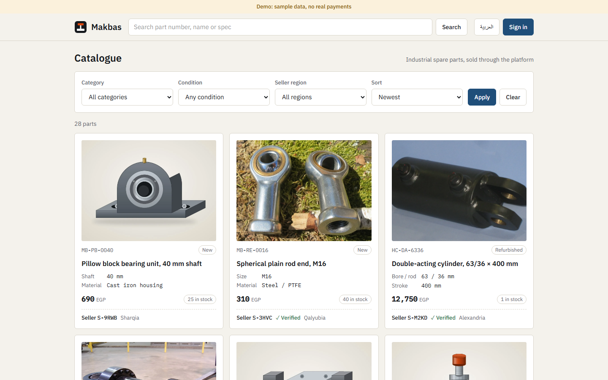
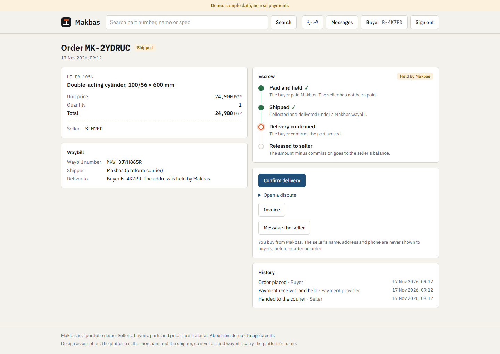
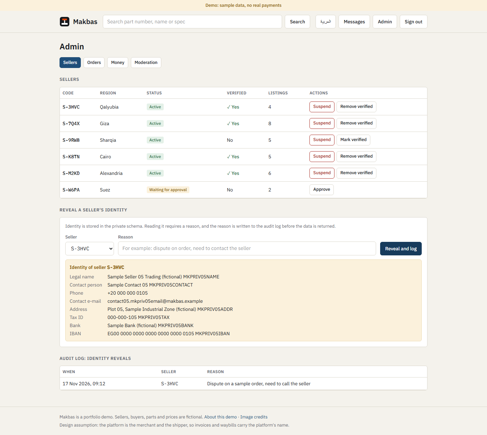
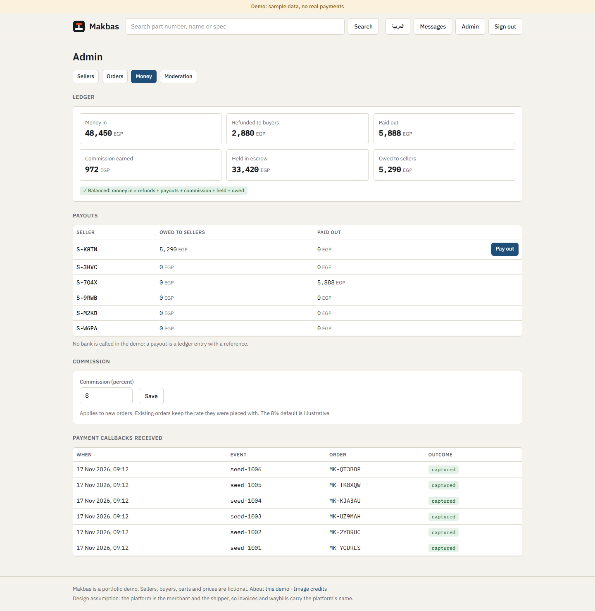
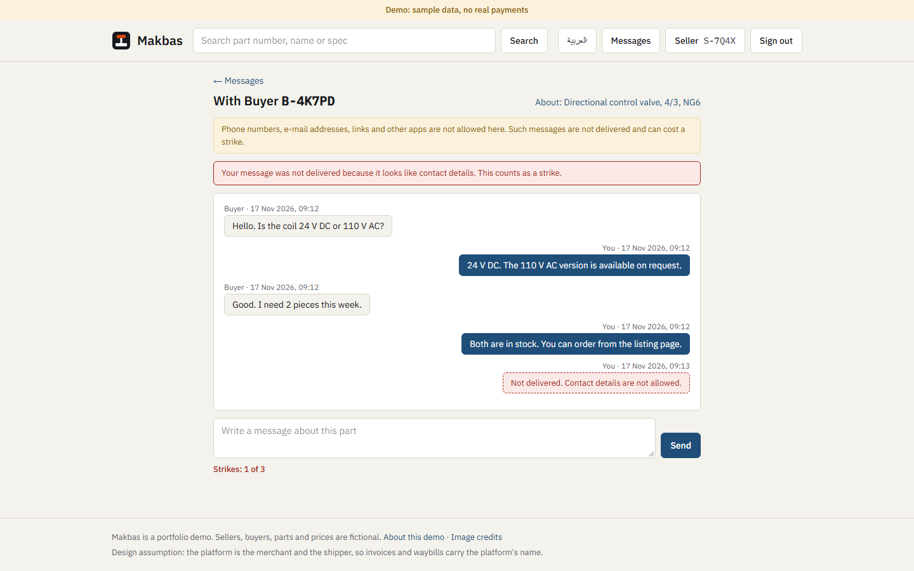

# Makbas

A working B2B marketplace demo for industrial spare parts (hydraulic and mechanical), in English and Arabic.
Buyers and sellers trade through the platform without learning who the other side is: sellers are shown
only as a code, the platform holds the money in escrow, and the built-in chat refuses phone numbers,
e-mail addresses and links.

**Live demo:** <https://makbas-nu.vercel.app> (one-click sign-in as buyer, seller, admin or a new seller)

> Demo: sample data, no real payments. All sellers, buyers, parts and prices are fictional. This is a
> portfolio project by Ahmed Shabayek, not client work. The data is reset every night.



## What you can do in the demo

| Sign in as | Try this |
| --- | --- |
| Buyer | Order a part, pay on the mock payment page (success or failure), confirm delivery, rate the seller, open a dispute, message the seller |
| Seller | See orders and balance, hand an order to the courier, edit listings (10 at most), upload a photo, try to send a phone number in chat |
| Admin | Approve sellers, reveal a seller's identity with a logged reason, resolve disputes, pay out sellers, change the commission, review stopped messages and listings |
| New seller | Go through onboarding from zero with a throwaway account |

| Screens | |
| --- | --- |
|  |  |
| Order page: escrow timeline, waybill in the platform's name | Admin: identity only with a reason, logged first |
|  |  |
| Ledger: money in = refunds + payouts + commission + held + owed | Chat: a phone number in Arabic-Indic digits is not delivered |

More screenshots are in [`docs/screenshots/`](docs/screenshots/).

## Stack

Next.js 16 (App Router, React 19, TypeScript), Tailwind CSS 4, Supabase (PostgreSQL 17 with row level
security, Auth, Storage, Realtime), deployed on Vercel. Migrations are plain SQL in
[`supabase/migrations/`](supabase/migrations/).

## Security design

The rule the whole project is built around: **a seller's name, address, phone and bank details must not
reach a buyer or another seller through any page, API response, file or error message.** The rule is
enforced in the database, not in the pages.

### Public and private data are in different schemas

| Schema | Holds | Who can reach it |
| --- | --- | --- |
| `public` | Seller code, region (governorate), verified flag, rating, listings, orders, delivered chat messages | Exposed by the Data API. Row level security on every table. Every grant is written by hand in a migration. |
| `private` | Seller and buyer identities, the link between a login and a seller or buyer id, roles, audit log, ledger, payment records, original text of stopped messages | Not exposed by the Data API. The roles used by visitors (`anon`, `authenticated`) have **no privilege on the schema at all**. |
| `app` | Small helper functions used by the policies | Functions only, no tables |

- A seller's public id is a random UUID that is **not** the login's id. The mapping is in `private`.
- Product links use a random reference (`P-8K2M4Q`), never a name. Sellers appear as a random code (`S-7Q4X`).
- The web app talks to the database with **the visitor's own session**, so row level security applies to
  every query a page makes. The privileged key is used in four places only: the seed, creating throwaway
  demo accounts, storing a re-encoded photo, and applying a verified payment callback or chat message.
- Everything a user may do with private data goes through a database function:
  `seller_onboard`, `seller_my_identity` (own data only; the id comes from the session, not from an argument).
- **The admin has no direct SELECT on identities either.** The only door is
  `admin_reveal_seller_identity(seller_id, reason)`, which writes the audit row *before* it returns the
  data, in the same transaction. An unaudited read is impossible by construction.

### Leak paths and what closes them

| Leak path | How it is closed | Checked by |
| --- | --- | --- |
| API responses returning whole rows | Private columns are not in any table a visitor can query | `tests/db/privacy.test.mjs` reads every table of every schema as visitor, buyer, another seller |
| Functions called with someone else's id | Functions take the caller from the session; admin functions check the role in the database | Same file: calls every function with another seller's id |
| GraphQL endpoint, auth admin API | Private schema is not exposed; normal sessions are refused | Same file |
| Ids and slugs | Random UUIDs and random codes; seller id is not the account id | Same file |
| Pages, React data payloads, headers | Pages select public columns only | `scripts/crawl-test.mjs` opens every page as 6 kinds of visitor, HTML and data payload |
| Shared caches | `Cache-Control: private, no-store` on every page; component cache switched off | Crawl test fails on any cacheable page |
| Image metadata (EXIF, GPS, file name) | Photos are re-encoded on the server with `sharp`, stored under a random name; users cannot write to the bucket | `tests/unit/photo.test.ts`, and a live upload check during the build |
| Seller-written listing text | Same contact filter as chat; a hit saves the listing as "under review", hidden until the admin approves | `tests/db/chat.test.mjs` (through the API, bypassing the app) |
| Chat | Server filter plus a second check in the database; stopped messages are invisible to the other party | `tests/unit/contact-filter.test.ts`, `tests/db/chat.test.mjs`, crawl test |
| Dispute text | The reason is a fixed code; the buyer's free-text note is for the admin only | `tests/db/ledger.test.mjs` |
| Reviews | Ratings are stars only, no text | `tests/db/ratings.test.mjs` |
| Invoice, receipt, waybill | Issued in the platform's name; the seller appears as a code | Crawl test covers invoice pages; assumption below |
| E-mail | The demo sends no e-mail at all | By design |
| Error messages | Database messages are mapped to fixed keys; an error page shows no details | Crawl test fails on any page that shows an internal message |
| Exact dates and "online now" | Sellers show the month they joined; there is no presence | By design |
| The admin's own tools | Identity only through the audited function | `tests/db/privacy.test.mjs` |

### The 10-product limit

A trigger locks the seller's row, counts the seller's products and refuses the 11th. Because of the row
lock, requests that arrive together wait for each other. The test sends 20 inserts at the same moment for
a seller with 8 products: exactly 2 succeed. A second test does the same with 12 parallel database
connections.

## Escrow and the ledger

```text
pending_payment -> paid_held -> shipped -> completed (released to the seller's balance) -> payout
                      |            |
                      v            v
                   refunded     disputed -> completed | refunded   (admin decides)
```

- An order changes state only inside database functions. Users have SELECT on orders and nothing else.
- Every money movement is one double-entry ledger transaction, written in the same database transaction
  as the state change. A constraint checks at commit that its entries sum to zero.
- The ledger is append-only: UPDATE and DELETE are refused for every role, including the owner.
- Commission is stored on each order when it is placed, so changing the rate affects new orders only.
  The 8% default is illustrative.
- Invariant checked after every test scenario and shown on the admin's Money page:
  **money in = refunds + payouts + commission + still held + still owed to sellers.**

## Payments

No real payment provider is connected and no real money moves.

- Paymob's test mode needs a merchant account; no self-service Fawry sandbox was found. So the demo uses a
  **mock provider** behind the same interface a real one would use.
- The mock is shaped like Paymob's "transaction processed" callback as documented on
  developers.paymob.com: a server-to-server POST with `{ "type": "TRANSACTION", "obj": {...} }`, the
  signature in `?hmac=`, HMAC-SHA512 over the 20 documented fields in the documented order
  ([`src/lib/payments.ts`](src/lib/payments.ts)). A unit test checks the signed string against the example
  in Paymob's documentation. It has **not** been run against Paymob itself.
- The webhook route checks the signature with a constant-time compare before anything else. The database
  then applies an event **at most once** per provider event id (unique index), and ignores a second
  success for an order that is already paid.

## Chat and the contact filter

- Users cannot insert a message directly. A message enters only through a database function that only the
  server may call, after the server has run the filter ([`src/lib/contact-filter.ts`](src/lib/contact-filter.ts)).
- The filter normalises the text first (Unicode folding, invisible characters removed, Arabic-Indic and
  Persian digits folded to 0-9, look-alike letters), then detects: phone numbers, also spaced out or
  spelled out in English, Standard Arabic and Egyptian Arabic; e-mail addresses, also written with
  "at" and "dot"; links; handles; other apps and "call me" requests; a number split over several messages.
- Verdicts: delivered, held for review (no strike), blocked (strike). Three strikes suspend a user's chat.
- The database runs its own simpler check as a second layer; it can only make the verdict stricter.
- A stopped message has an empty body in the public table. Its text is kept in the private schema for the
  admin's moderation queue. The other party receives no row at all, not even a placeholder.
- Live updates use Supabase Realtime with the visitor's own session, so the same row level security
  decides what a subscriber is told about.

**Limits, stated plainly:** any such filter can be worked around by determined users (an agreed code over
many messages, words the filter does not know, text inside a photo of the part). The filter raises the
cost; the moderation queue and strikes handle the rest.

## Tests

| Command | What it runs | Count |
| --- | --- | --- |
| `npm run test:unit` | Pure logic, no network | **97 tests** |
| `npm run test:db` | The real database API of the test project | **121 tests** |
| `npm run test:crawl` | Builds the app against the test project, opens every page as 6 kinds of visitor | about 80 to 125 pages per visitor, plus access and webhook checks |

Unit tests (97): contact filter 80 (phone numbers in three digit scripts, hidden with invisible
characters, spelled out, split over messages; e-mails; links; handles; and 21 ordinary sentences about
parts in English and Arabic that must pass), payment signature 5, photo metadata 4, money 4, sample images 4 (every listing has one, every
third-party photo has an author, a free licence and a source).

Database tests (121):

- **Privacy, 47.** For a visitor, a buyer, another seller and an unapproved seller: no table or view in
  any schema returns a private marker; the private schema cannot be queried; only `public` answers; no
  function returns a marker whatever it is called with; the reveal function refuses and leaves no audit
  row; GraphQL and the auth admin API give nothing. Plus control tests proving the scanner does find the
  markers where they really are, checks that no function is callable by anonymous visitors, and the
  audit-log tests for the admin.
- **10-product limit and ownership, 11.** Including the two parallel tests.
- **Orders and ledger, 36.** Full path to payout, wrong amount, failed payment, duplicate callbacks,
  refunds, both dispute outcomes, the last unit ordered by two buyers at once, 10 parallel callbacks,
  5 parallel confirmations, who may call what, ledger cannot be edited, unbalanced transaction refused.
- **Chat and moderation, 22.** No direct insert, five kinds of contact detail blocked end to end, split
  number, database second check, queue, release and confirm, three strikes, rate limit, listing guard.
- **Ratings, 5.**

How the privacy tests work: every private field in the sample data carries a marker such as
`MKPRIV01NAME`. The tests read everything a role can reach and fail if a marker shows up.

**Test isolation.** Heavy tests never touch the demo database. They run against a second Supabase project
and refuse to start if it is the demo project. One heavy run at a time: the runner holds a PostgreSQL
advisory lock for the whole run. Limits: 30 seconds per test, 10 minutes per run.

## Run it yourself

You need Node 24 and two free Supabase projects (one for the demo data, one for tests).

1. `npm install`
2. Put these names in `.dev.vars` (never committed): `SUPABASE_URL`, `SUPABASE_PUBLISHABLE_KEY`,
   `SUPABASE_SECRET_KEY`, `DATABASE_URL`, `DEMO_USER_PASSWORD`, `PAYMENT_HMAC_SECRET`, `CRON_SECRET`,
   and the same names with the prefix `TEST_` for the test project.
3. `npm run db:migrate -- --target demo` and `npm run db:seed -- --target demo`
   (the seed wipes the project's marketplace data and all its users, then creates the sample set).
4. `npm run dev`, then open <http://localhost:3000>.

On Vercel the app needs `NEXT_PUBLIC_SUPABASE_URL`, `NEXT_PUBLIC_SUPABASE_PUBLISHABLE_KEY`,
`SUPABASE_SECRET_KEY`, `DEMO_USER_PASSWORD`, `PAYMENT_HMAC_SECRET`, `DATABASE_URL` and `CRON_SECRET`.

## Images on the sample listings

Every sample listing has one image, for illustration only. None is a picture of an actual item for sale.

- **10 photos** are freely licensed works from Wikimedia Commons (CC0, public domain, CC BY, CC BY-SA).
  Each was checked for brand marks, resized and re-encoded. Author, licence and source page of each are
  in [`scripts/seed-images/credits.json`](scripts/seed-images/credits.json) and on the demo's
  [Image credits](https://makbas-nu.vercel.app/en/credits) page. They stay under their own licences.
- **20 drawings** were made for this project ([`scripts/draw-parts.py`](scripts/draw-parts.py)).
- No AI-generated images are used.

## Design assumptions

- **The platform is the merchant of record and the shipper.** Invoices and waybills carry the platform's
  name, and the platform collects from the seller and delivers to the buyer. Without this, anonymity
  cannot hold: a pickup address on a waybill identifies the seller.
- Buyers are shown to sellers only as a code as well. The seller never needs the buyer's address.
- What is inside the box (the seller's own packaging, stickers, a paper invoice) is an operational risk
  outside the software.

## Open questions for a real deployment

These were **not checked** and this project makes no claim about them:

- Whether holding buyers' money for sellers in Egypt needs a licence, or has to be done through a payment
  provider's own marketplace product.
- Tax and e-invoicing rules for a platform that is the seller of record.
- Consumer and commercial rules for refunds and disputes.
- Data protection rules for storing sellers' identity documents.

Also not built: delivery auto-confirmation after a number of days, refund of a payment that arrives after
the buyer cancelled, real e-mail, real payouts, object storage outside Supabase, rate limiting at the
edge. Open sign-up is switched off in the demo on purpose, so it collects no real personal data.

## Project layout

```text
supabase/migrations/   schema, policies, functions (0001 core, 0002 orders and ledger, 0003 chat, 0004 ratings)
src/app/[locale]/      pages and server actions (English and Arabic)
src/app/api/           payment webhook, nightly reset
src/lib/               contact filter, payment signature, photo re-encoding, session, texts
scripts/               migrate, seed, sample data, crawl test
tests/unit, tests/db   unit tests and database tests
```

## Licence

MIT for the code and the drawings. See [LICENSE](LICENSE). The ten third-party photos in
`scripts/seed-images/` are not covered by it: each keeps the licence listed in `credits.json`.
